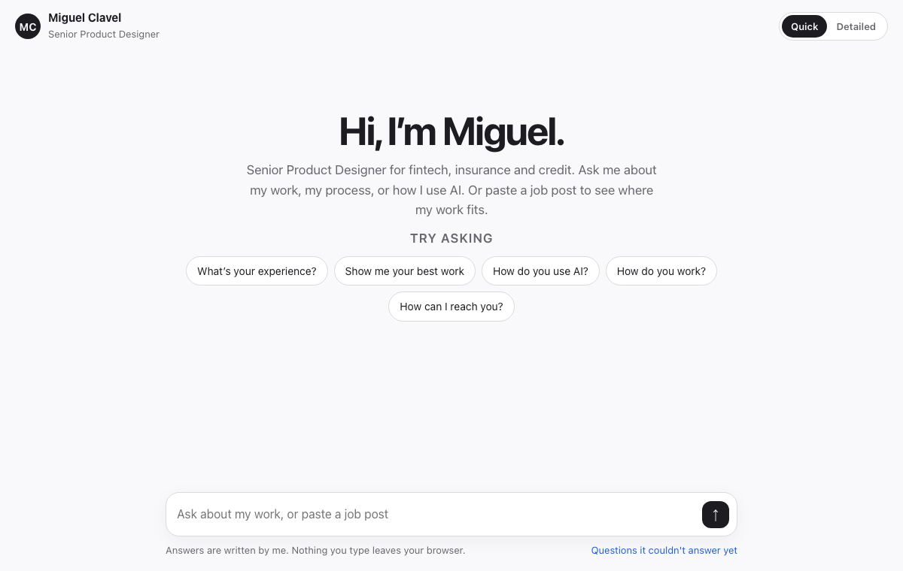

# Portfolio chat starter

A portfolio people can talk to, in one file. Fill in your own answers and projects, and visitors can ask about your work, your process or how you use AI, or paste a job post to see where your work fits.

<picture>
  <source media="(prefers-color-scheme: dark)" srcset="assets/answer-dark.png">
  
</picture>

**[Try it](https://miguelclavel.github.io/portfolio-chat-starter/)** · one file, `index.html`, no libraries, no build step, no AI service.

It's the simple, open version of my own [portfolio you can talk to](https://github.com/miguelclavel/chat-portfolio), which runs at [chat.miguelclavel.com](https://chat.miguelclavel.com/?utm_source=github&utm_medium=chat-starter).

## What it does

- **Answers only with what you wrote.** No model at runtime, so it can never make things up about you. Every answer says it was written by you.
- **Understands people the way they type.** Typos ("experiance", "wrok"), apostrophes straight or curly, and questions about you in the third person ("tell me about Miguel's work") all reach the right answer.
- **Quick or detailed.** A short answer by default, a longer one for people who want the decisions and process.
- **Matches a job post.** Paste a job description and it ranks your projects by the skills the post asks for, and highlights the matching ones.
- **Suggestions written as questions.** "What's your experience?" reads as something to tap. "Experience" reads like a tag.
- **Shows what it couldn't answer.** Unanswered questions are kept in the visitor's own browser, so when you test it you can see what to write next.

## Make it yours

Everything you change is in the `CONTENT` object at the top of the script:

1. `name`, `title`, `hello`, `intro` and the `suggestions` people can tap.
2. `aliases`: the ways people refer to you (your name, first name, "he", "she", "they"), so third person questions work.
3. `answers`: each has `words` that reach it, a `quick` and a `detailed` version, and optional `links`.
4. `projects`: each with a link and the `skills` it shows, for the job post matcher.

Open `index.html?ask=your question` to test any question straight away.

## How the matching works

1. **Normalise.** Lowercase, straighten apostrophes, drop punctuation, and turn your name or "he" into "you".
2. **Forgive typos.** Unknown words are matched to the closest known word within one or two letters, and two swapped letters count as one slip.
3. **Score.** Each answer scores the words it shares with the question. The best one above a threshold wins; otherwise it says it doesn't know yet, and suggests questions it can answer.

The weekly habit that makes it good: look at what people asked that it couldn't answer, write those answers, and the chat gets better every week. Mine has more than 2,000 real and test questions behind it now.

---

MIT licensed. Made by [Miguel Clavel](https://miguelclavel.com/?utm_source=github&utm_medium=chat-starter) with Claude Code. The sample content is mine; replace it with yours.
